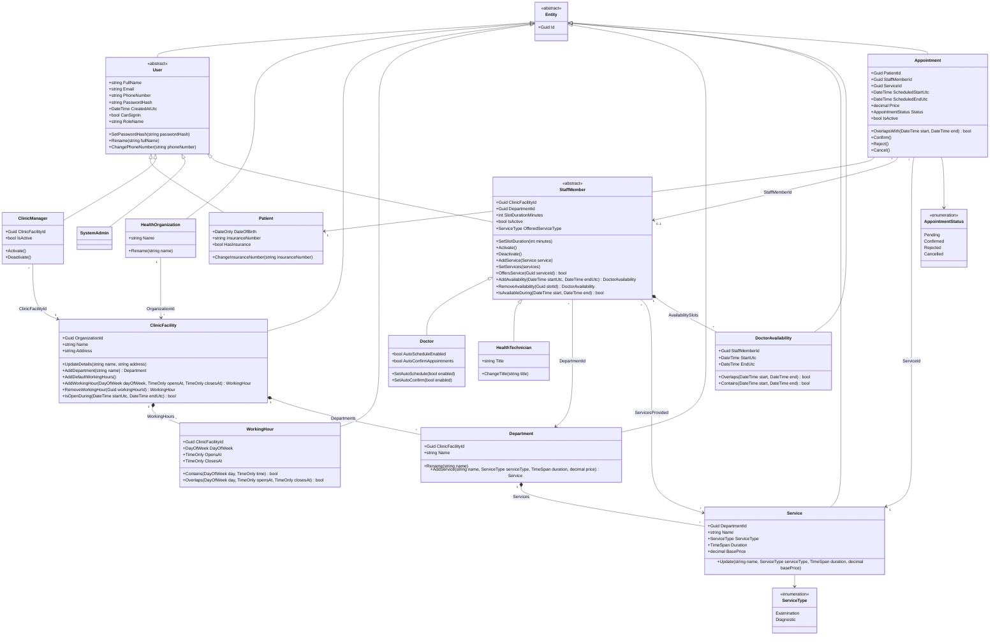
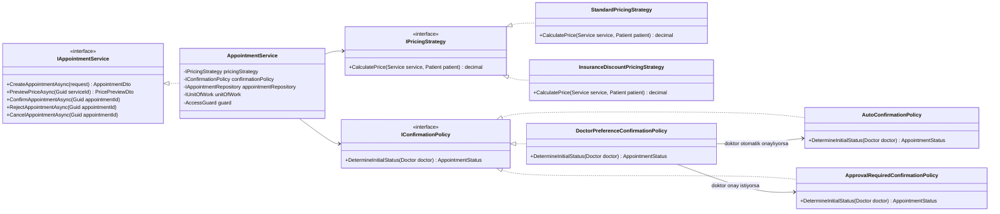
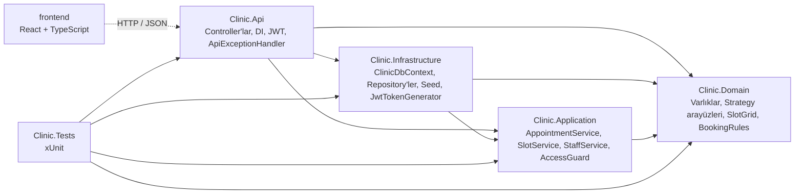

# UML Sınıf Diyagramları

Bu belgedeki diyagramlar [Mermaid](https://mermaid.js.org/) ile yazılmıştır; GitHub, VS Code (Markdown önizleme) ve
<https://mermaid.live> üzerinde görüntülenir. Sınıf, üye ve dosya adları koddaki adlarla aynıdır; kolay okunması için
yalnızca önemli üyeler gösterilmiştir.

## 1. Alan modeli (Clinic.Domain)

Tüm varlıklar `Entity` soyut sınıfından `Id` alır. Kullanıcılar `User` soyut sınıfı altında bir kalıtım ağacı oluşturur:
`Patient`, `ClinicManager`, `SystemAdmin` ve soyut `StaffMember` (onun alt sınıfları `Doctor` ve `HealthTechnician`).
Kurum yapısı `HealthOrganization` -> `ClinicFacility` (şube) -> `Department` -> `Service` zinciridir; `Appointment`,
hasta, hizmet ve (muayenede) personel kaydına kimlikle bağlanır, tetkik randevusunda `StaffMemberId` boştur.

Notlar: `User.RoleName` soyut bir özelliktir ve her alt sınıf kendi değerini döndürür (çok biçimlilik). `StaffMember.OfferedServiceType`
da soyuttur: `Doctor` için `Examination`, `HealthTechnician` için `Diagnostic`. `Appointment.StaffMemberId` tetkik
randevusunda boştur (`Guid?`). Tüm kullanıcı sınıfları veritabanında tek `Users` tablosunda, `UserType` ayırt edicisiyle saklanır.

## 2. Strateji deseni (fiyat ve onay kuralı)

`AppointmentService`, fiyatı `IPricingStrategy` ile, ilk randevu durumunu `IConfirmationPolicy` ile belirler; somut sınıfları
bilmez, yalnızca arayüzlere bağlıdır. Hangi uygulamanın kullanılacağı `Clinic.Infrastructure/DependencyInjection.cs` içinde
tek satırla seçilir (şu an `InsuranceDiscountPricingStrategy` ve `DoctorPreferenceConfirmationPolicy`); servis kodu değişmez.

`InsuranceDiscountPricingStrategy`, sigorta numarası olan hastaya fiyatın %20 indirimlisini uygular; `StandardPricingStrategy`
her zaman `BasePrice` döndürür. `DoctorPreferenceConfirmationPolicy`, doktorsuz (tetkik) veya otomatik onaylayan doktorlu
randevuyu `Confirmed`, onay isteyen doktorlu randevuyu `Pending` başlatır; kararı iki basit politikaya yönlendirir.

## 3. Katmanlar ve bağımlılıklar

Oklar "bağımlıdır / başvurur" yönünü gösterir (proje referansları `.csproj` dosyalarındaki `ProjectReference` kayıtlarıdır).
`Clinic.Domain` hiçbir katmana bağımlı değildir; `Clinic.Api` hem `Clinic.Infrastructure` hem `Clinic.Application` hem de
`Clinic.Domain` projesine başvurur.

Bağımlılık yönü içe doğrudur: iş kuralları `Clinic.Domain` ve `Clinic.Application` içinde kalır, EF Core ve JWT gibi
ayrıntılar `Clinic.Infrastructure` içindedir. Application katmanı repository'leri yalnızca `Clinic.Domain.Repositories`
altındaki arayüzler (`IAppointmentRepository`, `IUnitOfWork` vb.) üzerinden kullanır; uygulamalar Infrastructure'dadır.

## Doğrulama notu

Bu ortamda Mermaid komut satırı aracı (`mmdc`) kurulu olmadığından diyagramlar otomatik olarak çizdirilmedi; söz dizimi
elle gözden geçirildi (`classDiagram` ve `flowchart` yapıları, çok kardinalite etiketleri, tırnaklı düğüm etiketleri).
Görüntülenmiyorsa <https://mermaid.live> üzerinde açıp deneyebilirsiniz.
